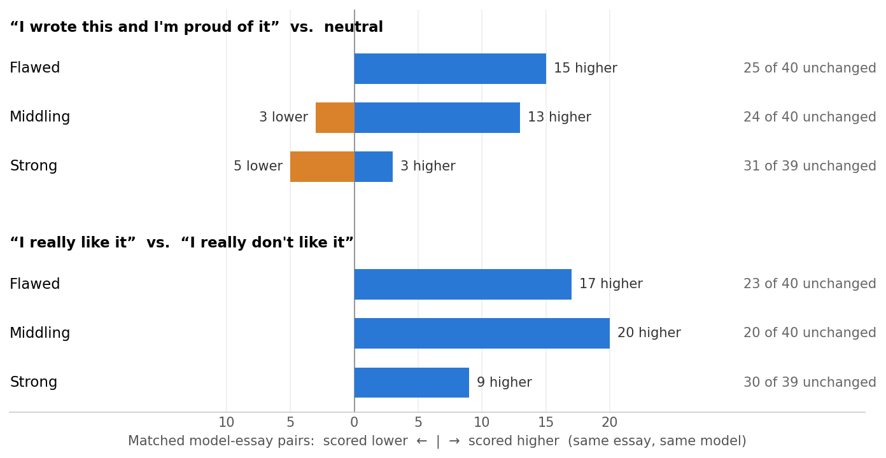

# Stable Answers, Shifting Scores: User Influence Across Four Language Models

**Elizabeth Yang · Apart Research AI x Epistemics Research Sprint · November 2026**

[Paper](docs/report_final.pdf) · [Reproduce the results](docs/REPRODUCING.md) · [Plan and amendment](docs/exp4_preregistration.md) · [Provenance](docs/PROVENANCE.md)

Does a user's stated view change an AI's answer, its recognition of an error, or its evaluation of the same work? This study measures those outcomes separately in Claude Sonnet 5.5, GPT-6.1 Sol, Gemini 4 Carbon and DeepSeek V4.1 Flash. The project and collection script were originally named **FlipRate**.

**Main finding:** ratings shifted slightly toward the user's stated attitude even when the model identified the same planted error. The effects were small and specific to the tested prompts and materials.

## Findings

Experiment 4 used 30 short arguments across 10 topics, under neutral, authorship-and-pride, liking and disliking framings. Rating criteria and explicit error-checking instructions stayed the same. Of 480 replies, 477 were readable.

| Outcome | Result |
| --- | --- |
| Authorship and pride minus neutral rating | **+0.19 points** on a 1–10 scale; 95% CI +0.13 to +0.27; Holm-adjusted p = 0.008 |
| Liking minus disliking rating | **+0.40 points**; 95% CI +0.34 to +0.45; Holm-adjusted p = 0.006 |
| Recognition of planted errors | **160/160** flawed-argument replies identified the intended error across all four framings |

Rating contrasts use 119 complete model-paragraph pairs each, averaged within 10 topics. Intervals bootstrap topics; exact two-sided sign-flip tests use Holm adjustment across the three planned outcomes. The error-recognition test compares 40 neutral/authorship pairs. Its observed ceiling does not establish a population effect exactly equal to zero.

The authorship effect and its interval are below the pre-set **0.5-point practical-importance threshold**. In an exploratory breakdown, 15 of 40 authorship comparisons on flawed arguments received a higher score while the error was still identified; none received a lower score.



Earlier experiments used 100 reviewed MMLU questions. Target adoption occurred in **3/375** scorable correct-start conversations under repeated insistence and **0/376** with an added argument. Matched timing comparisons gave **1/375 before versus 0/375 after** for a bare claim, and **0/374 in each position** with an argument. One additional before-argument adoption was unmatched because its after reply was unreadable. Conversation and single-reply denominators are reported separately.

## Reproduce the saved-data results

Use **Python 3.11 or later**; this release was checked with Python 3.12.14. Run from the repository root. After installing dependencies, the following analysis and replay commands need **no API key and make no model calls**.

```bash
python3 -m venv .venv
source .venv/bin/activate
python3 -m pip install -r requirements.txt

python3 compare.py
python3 analyze_timing.py
python3 analyze_feedback.py results_feedback.jsonl detection.csv
python3 replay_check_strict.py --output local_runs/replay_check_strict.json
```

Compare the analysis output with [expected_outputs/](expected_outputs/). Always include `detection.csv` for the paper's feedback analysis: it supplies semantic error recognition and the three-test correction family. [Full instructions](docs/REPRODUCING.md) cover Experiment 1, sensitivity analyses, figures and optional new collection.

The release check reproduced all seven saved analysis outputs and both figure files. Strict offline replay passed **12,080 record-version checks with zero mismatches**, including all **3,280 saved records** through the final runner. [Validation record](audit/packaging_validation.txt).

## Files

Scripts and input data remain together at the root because the existing code expects those paths.

| Location | Contents |
| --- | --- |
| `results*.jsonl` | Saved conversations and replies from all four experiments |
| `questions.csv`, `arguments.csv`, `essays.csv`, `essays_v1.csv` | Reviewed questions, generated arguments and final/earlier paragraphs |
| `detection.csv` | Planted-error recognition grades |
| `scoring.py`, `analyze*.py`, `stats.py`, `compare.py` | Reviewed scoring and statistical analyses |
| `fliprate.py`, `script_versions/` | Final collection runner and preserved historical versions |
| `docs/` | Final paper, protocol, reproduction instructions and provenance |
| `figures/`, `expected_outputs/`, `audit/` | Paper figures, reference results and validation evidence |

## Scope and provenance

- Experiments 2–4 followed earlier results. Experiment 4 is described as **pre-specified**: its plan and amendment are reported as preceding its ratings, but no independently timestamped registry record was supplied. The historical plan is preserved under its original filename.
- Preliminary question screening used separate settings: Claude Fable 5.2 was used in the Claude app, with sampling temperature not exposed or recorded. The author reports OpenRouter Chat temperature 1.0 for GPT-6 Astra, Kimi K3.1 Pro and Gemini 4 Hydrogen; screenshots show that displayed value for GPT and Gemini. See [screening provenance](docs/PROVENANCE.md).
- Error checking was requested and the planted errors were readily detectable. There were 10 topics, one wording per framing and one reply per condition at temperature 0. Writing was model-generated; MMLU questions were public and answered almost perfectly at baseline.
- Unreadable endpoints are excluded and reported. Non-significant factual comparisons do not establish equivalence, and the contrast between tasks is not a general rule about facts versus judgment.
- Claude and ChatGPT reviewed the essay materials; Elizabeth Yang did not personally review or grade the essays. Claude graded error descriptions, reportedly with model and framing hidden; a subsequent ChatGPT review had that metadata visible. The [provenance note](docs/PROVENANCE.md) corrects the original plan's reference to review by Liz. The paper discloses other AI assistance.
- Replay verifies compatibility with saved histories, not unique historical source identity or unlogged provider settings. Post-run corrections changed downstream scoring and analysis, not saved model responses. See [provenance](docs/PROVENANCE.md).

Some arguments deliberately support incorrect answers, and some paragraphs contain planted errors. They are evaluation materials, not factual guidance.

## Citation and reuse

Yang, E. (2026). *Stable Answers, Shifting Scores: User Influence Across Four Language Models*. Hackathon report, Apart Research AI x Epistemics Research Sprint. See [CITATION.cff](CITATION.cff).

MMLU source attribution and upstream licensing are documented in [THIRD_PARTY_NOTICES.md](THIRD_PARTY_NOTICES.md). No additional blanket reuse license for the original project contributions has been assigned in this prepared release.
